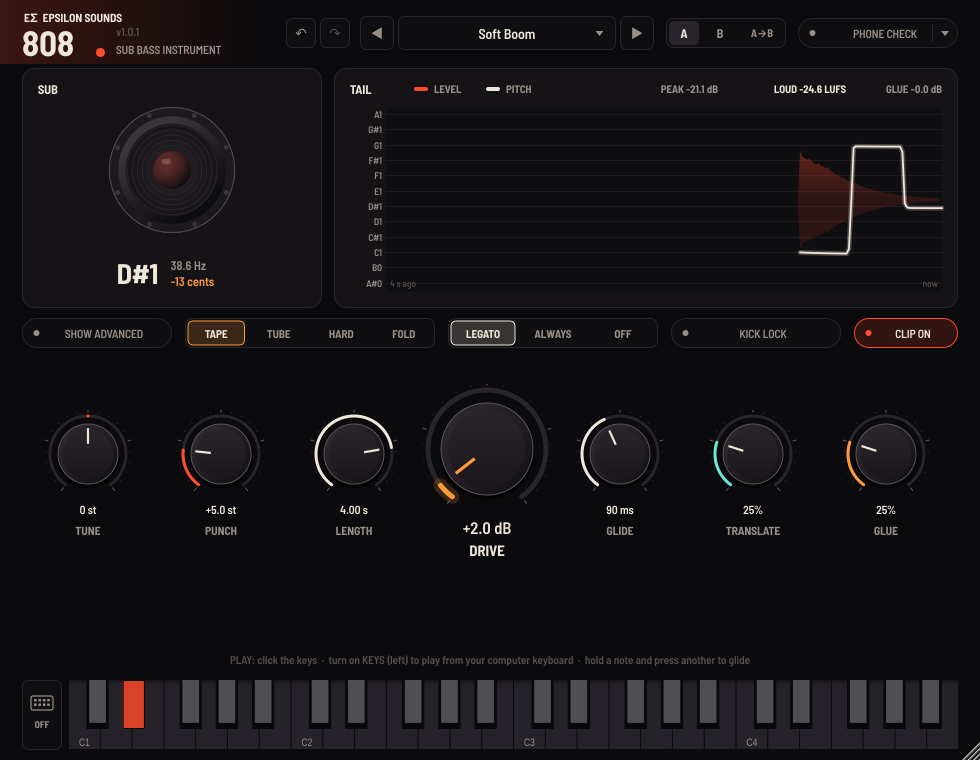
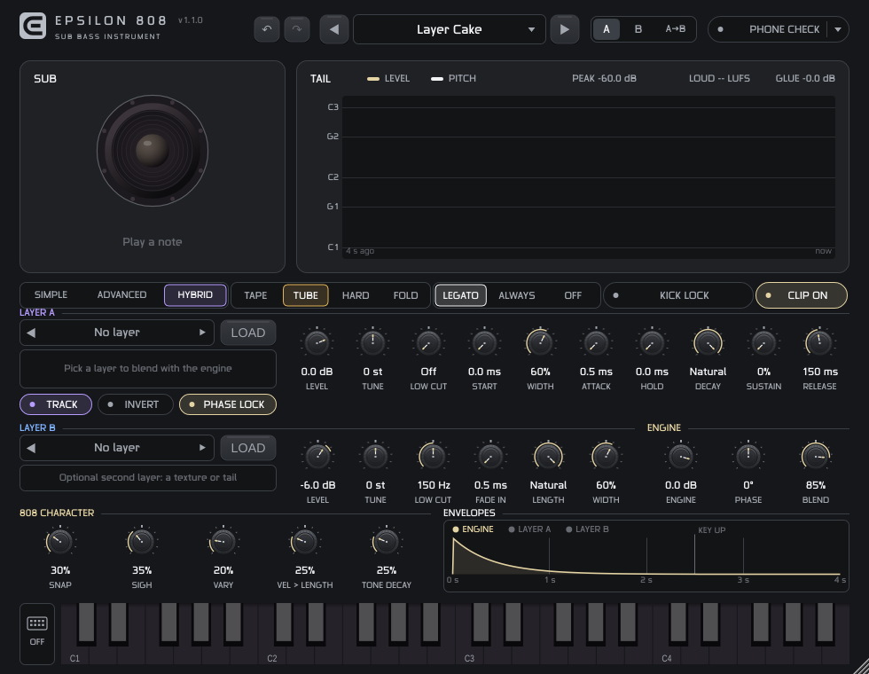
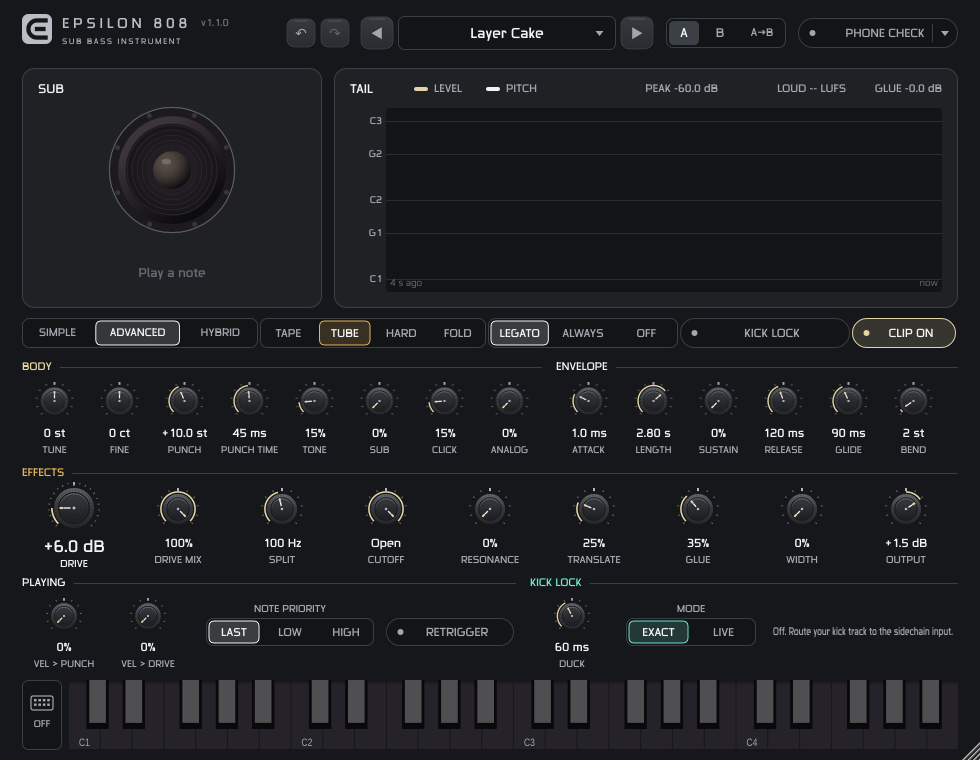
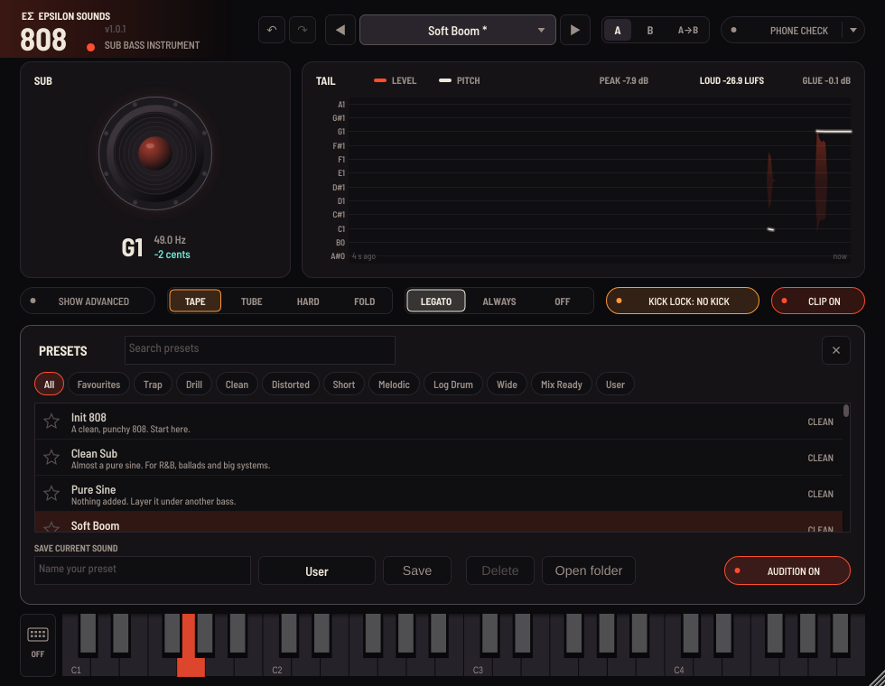

# Epsilon 808

**The 808 that's heard everywhere and never fights your kick.** A mono sub-bass instrument (VST3 / AU) by Epsilon Sounds, with the producer chain built in: punch, glide, four anti-aliased drive flavours with **Split** (clean sub under the grit), a filter, **Translate** (harmonics so the 808 is heard on phones), one-knob **Glue**, mono-safe **Width**, a clean **Clip**, **Kick Lock** (phase-aligns and ducks the 808 against your kick) and **Phone Check** with four device curves.



Version 1.1.0. Built with JUCE 9.0.5, C++17. macOS 12+ (universal), Windows (VS2022). Engine tests, plugin bench and pluginval (strictness 8, with editor tests) pass on Linux. The release gate is a Mac build and an FL Studio session.

## What's new in 1.1: Hybrid



v1.0's presets were clean and tight, but every hit was identical and the body was a pure synth: it read as machine-made. 1.1 fixes that two ways.

**1. Sample layers, blended with the engine.** Two layers sit on top of the engine (HYBRID page; Layer A is also on SIMPLE):

| | |
|---|---|
| **Layer A** (character) | A sample's punch, grit and stereo. Level, Tune, Low Cut, Start, Width and its own envelope: Attack, Hold, Decay, Sustain, Release. Track (follow the keys and slides) and Invert. |
| **Layer B** (texture) | A second sound for a tail, a texture or an octave on top: Level, Tune, Low Cut, Fade In, Length, Width. |
| **Engine** | The synth body and click can be turned down to Off: the layers alone, still tuned and gliding. |
| **Phase Lock** | On every note the engine starts on the phase that lines up with Layer A's fundamental once the punch settles. Engine + layer stay within 0.04 dB of a perfect sum at any sample phase; without it they cancel by up to 15 dB. **Phase** offsets it to taste. |
| **Auto-tune** | Each built-in sound carries its measured fundamental, so a sample recorded 30 cents sharp still plays in tune. Your own samples are analysed when you load them. |
| **Your samples** | LOAD (or "Load a sample..." in the list) takes WAV, AIFF or FLAC. The session remembers the file. |

Layers play at 4x with cubic interpolation, follow note, glide and bend (not the punch), go through the drive with the engine, and keep their stereo above 150 Hz only, so the low end stays mono.

**Built-in sounds (23):** 6 808s, 4 basses and 5 reeses (Cymatics "Orchid"), plus 8 **Fusions** made by combining them: Heavy Reese, Talking 808 (an 808 reshaped by a reese's vowels, by cross-synthesis), Glass Donk (the Donk through a slice of a reese), Frozen Whale (a reese frozen in time over an 808), Grit Stack (three basses phase-aligned and glued), Rum Stretch (the short Rum stretched 3x with its grit kept), Brooding Ring and Eternity Pluck (an endless reese forced into an 808's shape). `tools/make_fusions.py` builds them; `tools/make_layers.py` installs any set of sounds into the project.

**2. 808 character, from how the TR-808 bass drum actually behaves:**

| Control | What the hardware does | What it does here |
|---|---|---|
| **Snap** | For about 6 ms after the trigger, the bridged-T network rings more than an octave higher. Too short to hear as pitch; it is the crack of the hit. | +19 st for 5 ms, then a 1.5 ms fall. |
| **Sigh** | Leakage in the retrigger path pulls the pitch down slowly over the first ~300 ms. | Up to +3 st, settling over ~300 ms; harder hits sigh more. |
| **Vary** | Component tolerances (5-20%) and the trigger level make no two hits or units the same. | Per hit: level +-1.5 dB, length +-15%, punch +-12%, tone +-30%, +-5 cents. |
| **Vel > Length** | Accent drives the circuit harder: louder *and* longer. | Soft hits up to 65% shorter. |
| **Tone Decay** | On a driven 808 the harmonics fade before the body. | Tone's harmonics follow the envelope, so the tail goes darker. |

Every factory preset now carries a light baseline of these (Snap 30, Sigh 25, Vary 20, Vel > Length 25, Tone Decay 25) unless it sets them itself; Pure Sine stays pure.

**Every preset is a hybrid.** All 75 presets except Pure Sine blend the engine's sine with a sample layer, phase-locked: the 41 v1.0 presets and the Basic 808s each got the sound that suits them (Heavyweight under the long trap and drill 808s, Short and Rum under the knocks, Cyclical, Reaper and Grit Stack under the distorted ones, Perfect Donk under the log drums, the reeses under the wide ones). Where a preset is shorter than its sample, the layer's Decay follows the preset's Length. Set Layer A to Off for the engine alone.

**New presets (35):** Basic 808 (8, voiced from the research), Hybrid Trap (8), Hybrid Drill (5), Hybrid Dembow (6) and Game Changers (8: Layer Cake, Frozen Whale, Eternity Pluck, Brooding Ring, Drillbow, Talking Grit, and two engine-off sample instruments). All presets are loudness-matched to -12.8 LUFS on the audit phrase (docs/preset-audit.txt).

> **About the Cymatics sounds.** The 15 Orchid samples, and the Fusions made from them, are built into this build for Edison's own productions. No licence file came with the pack, and most sample-pack licences allow use in music but not redistribution inside a product. Before selling or giving away Epsilon 808, replace them: put sounds you own or may redistribute in a folder with a `manifest.json` and run `tools/make_layers.py`, then rebuild. The engine and presets do not depend on which sounds are installed (presets name their layers; rename those to match).

## What was new in 1.0

| Feature | What it does |
|---|---|
| **Kick Lock** | Route your kick into the sidechain input. On every kick the 808 restarts its cycle in phase with the kick, so the two add up instead of cancelling, and ducks for the **Duck** time so the kick's front comes through. **Exact** mode looks 5 ms ahead and lines up perfectly (the delay is reported to your DAW, which compensates it). **Live** mode adds no delay, for playing live. |
| **Split** | Below the Split frequency you hear the clean 808, above it the driven one. Under +30 dB of Hard drive, the 44 Hz sub stays within 0.1 dB of the clean 808. |
| **Cleaner drive and clip** | Every drive shape is anti-aliased (ADAA at 4x). The output clipper runs at 2x with ADAA and a gentle guard knee. Measured with +36 dB drive pushed +6 dB into Clip: aliasing is about −90 dB in C1–C3 and −70 dB at C4, 26 to 33 dB cleaner than v0.9 at C4. Peaks stay under 0 dBFS. |
| **Phone Check devices** | Phone, Laptop, Earbuds and Car (approximate curves). Car is the opposite test: does the sub get too big? |
| **Analog** | Pitch droops up to 30 cents as the tail fades, each note sits a few cents apart, the attack is rounder. 0% = exact. |
| **Playing** | Velocity to Punch and to Drive; note priority (Last, Low, High); Retrigger (fresh punch on every slide). |
| **Presets** | 41 factory presets in 9 categories (Trap, Drill, Clean, Distorted, Short, Melodic, Log Drum, Wide, Mix Ready) plus your own, each with a one-line description. All factory presets are loudness-matched (−13.5 LUFS ±0.4 on a test phrase), so switching compares sounds, not levels. Save, search, favourite, delete, click-to-audition. |
| **Workflow** | Undo / redo (Cmd/Ctrl+Z), short-term loudness meter (LUFS), keyboard velocity by click position, computer-keyboard playing as a toggle (off by default in a DAW). |



## Controls

- **Body.** Tune, Fine, Punch (how far above the note each hit starts), Punch Time, Tone (2nd and 3rd harmonics), Sub (octave down), Click, Analog.
- **Envelope.** Attack, Length (time to fall 60 dB), Sustain, Release, Glide, Bend (wheel range).
- **Effects.** Drive with Tape / Tube / Hard / Fold, Drive Mix, Split, Cutoff, Resonance, Translate, Glue, Width, Output.
- **Playing.** Vel > Punch, Vel > Drive, Note Priority, Retrigger, Glide mode (Legato / Always / Off).
- **Hybrid.** Layer A (sound, Level, Tune, Low Cut, Start, Width, Attack, Hold, Decay, Sustain, Release, Track, Invert), Layer B (sound, Level, Tune, Low Cut, Fade In, Length, Width), Engine level, Phase Lock, Phase.
- **808 Character.** Snap, Sigh, Vary, Vel > Length, Tone Decay.
- **Kick Lock.** On/off pill (it says KICK LOCK: NO KICK until a kick arrives on the sidechain), Mode (Exact / Live), Duck.
- **Monitoring.** Phone Check with the device menu (never saved in presets), A/B compare, undo/redo.

**Displays.** The speaker cone moves with the low end, glows with the level, and shows a teal ring when Translate adds harmonics. Under it: note, frequency and cents off the nearest note. The **Tail** view shows four seconds of level and pitch, with teal ticks where Kick Lock caught a kick and shading where it ducked; above it: PEAK, LOUD (short-term LUFS) and GLUE gain reduction.

## Presets



**1.0.1:** every factory preset was re-voiced and measured on the same 4-bar trap phrase. Distorted presets now keep a clean sub with Split, the long and melodic ones carry enough Translate to be followed on a phone (every non-Clean preset stays within 19.5 dB of its full-range loudness through Phone Check), and every preset lands at −13.5 LUFS (gated, BS.1770) within ±0.4 LU, so the loudest one no longer wins by default. The measurements are in `docs/preset-audit.txt`.

Click the preset name to open the browser. Click a preset to load it (with Audition on, it plays a short G1 so you hear it straight away); double-click to load and close; click the star to favourite. **Save** writes the current sound as a file in `~/Music/Epsilon Sounds/808/Presets/` (Mac) or `Music\Epsilon Sounds\808\Presets\` (Windows), so presets move between computers and DAWs. Factory presets are also exposed to the host as programs.

## Setting up Kick Lock

1. Turn on Kick Lock in the plugin.
2. Send your kick track to Epsilon 808's sidechain input (the input bus is called **Kick**):
   - **Ableton Live:** in Epsilon 808's device title bar, open the sidechain section and pick the kick track.
   - **Logic Pro:** choose the kick track in the plugin window's Side Chain menu.
   - **FL Studio:** route the kick's mixer track to the 808's mixer track with "Sidechain to this track", then pick it in the plugin's input settings. Confirm this in the release check: FL Studio's handling of instrument sidechain inputs is the one route not yet verified.
3. The pill changes from KICK LOCK: NO KICK to KICK LOCK ON and flashes on each kick.

## Tips from the designer

1. **Tune first.** Play your song's root and watch the cents readout, then set Tune.
2. **Phone Check, then Translate.** Switch Phone Check on and raise Translate until you can follow the bassline (30–50% is typical). Then try Car: if the sub booms, lower Sub or Length.
3. **Heavy distortion without losing weight:** Drive +20 dB or more, Split at 90–120 Hz. Drive Mix can stay at 100%.
4. **808 and kick together:** turn on Kick Lock with Duck 40–80 ms. With a separate kick, you can usually remove the sidechain compressor you used before.
5. **Drill:** Glide mode Always, Glide 180–260 ms, Note Priority Low, Retrigger on so every slide still knocks.
6. **Log drums:** start from the Log Drum presets and play from C1; Tune puts them an octave up.
7. **Accents:** Vel > Punch 40–60% makes programmed velocities matter.

## Try it in the browser

`docs/epsilon-808-lab.html` runs the same engine in Web Audio over a four-bar 140 BPM trap beat (synthesised kick, clap and snare, 808-style hats, keys and a room; the kick feeds Kick Lock), all 41 presets and one-click demos for Translate, the drive flavours, glide styles, Kick Lock, Split and punch.

## Build

**Projucer (recommended):** open `Epsilon-808.jucer` and click the Xcode (or Visual Studio) icon, then build the VST3 / AU targets. JUCE 9.0.5 sits in `./JUCE` in the Projucer package. Debug builds are optimised (-O3).

**CMake:**
```
git clone --depth 1 --branch 9.0.5 https://github.com/juce-framework/JUCE.git JUCE
cmake -S . -B build -G Xcode -DCMAKE_OSX_ARCHITECTURES="arm64;x86_64"
cmake --build build --config Release --target Epsilon808_VST3 Epsilon808_AU
```

**Engine tests** (no JUCE needed, 41 checks including the hybrid layers and 808 character): `cmake --build build --target BoomEngineTests && ctest`, or
`g++ -O3 -std=c++17 -ISource Tests/EngineTests.cpp Source/Boom808Engine.cpp && ./a.out`.

**Plugin bench** (real processor: every preset's loudness, layers decode, user samples, state, editor snapshots):
`cmake -S . -B build -DE808_BUILD_BENCH=ON && cmake --build build --target PluginBench && ./build/PluginBench_artefacts/Release/PluginBench`
(`--snap docs` renders the three views to PNG).

CI (`.github/workflows/build.yml`, manual or on `v*` tags) builds universal VST3 + AU on macOS and runs the engine tests, auval (`aumu E808 EpsS`) and pluginval.

## Verification (this version)

- **Engine, 27 checks:** tuning within ±0.002 cents at 44.1/48/96 kHz; punch; glide and glide-back; click-free retrigger; drive and clipper aliasing; Split flat with no drive and sub unchanged under drive; note priority; Retrigger; Analog droop; velocity to Punch; Kick Lock (808-to-kick correlation from −0.97 to +0.95, Exact and Live); Translate; Width mono-safe; Phone Check models; Clip peaks; CPU about 5% of one core with everything on. See `docs/engine-test-results.txt`.
- **Plugin bench:** MIDI to sound, all 41 presets play under 0 dBFS, state and A/B round trips, Kick Lock bus and reported latency (23 samples, or 263 at 48 kHz in Exact mode), user preset save/load/delete, favourites, undo, editor snapshots. See `docs/plugin-bench-results.txt`.
- **pluginval 1.0.4, strictness 8, including editor tests:** SUCCESS. See `docs/pluginval-linux-strictness8.txt`.

## Identity

Manufacturer code `EpsS`, plugin code `E808`, bundle `com.epsilonsounds.e808`, AU type `aumu`, VST3 category Instrument|Synth, sidechain input bus "Kick". Font: Barlow Semi Condensed (SIL OFL, `Resources/Barlow-OFL.txt`).

© Epsilon Sounds.
